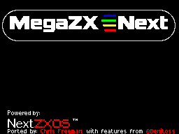

MegaZXNext boot screen for the ZX Next firmware
================================================

The ZX Next firmware (`TBBLUE.FW`) picks its boot screen by the machine ID. This core reports
0xDA ("MiSTer"), so the firmware shows "MiSTer Next". `zxn_bootscreen.py` writes a copy of
`TBBLUE.FW` in which that screen shows the MegaZXNext logo and the credit line "Ported by: Chris
Freeman with features from @Benitoss" instead; "Powered by NextZXOS" and the other boot screens
stay as they are.



Usage (Python 3, no other packages):

```
python3 zxn_bootscreen.py patch TBBLUE.FW TBBLUE-megazxnext.FW
python3 zxn_bootscreen.py show  TBBLUE.FW screens/      # all 8 boot screens as PNG
```

Then replace `/TBBLUE.FW` **inside the ZX Next image** (or on the real ZX Next card) with the
patched file, renamed to `TBBLUE.FW`. Keep the original: a new System/Next distribution or a
firmware update brings back the original screen, and you can run the tool again on the new file.

Files:

* `zxn_bootscreen.py`: the patch tool. Its header explains how the firmware stores the screens.
* `make_logo.py`: makes `megazxnext.scr` from `doc/assets/megazxnext-badge.png`
  (`python3 make_logo.py ../../doc/assets/megazxnext-badge.png megazxnext.scr preview.png`).
  Only the top 10 character rows (logo) and row 23 (credit line, `CREDIT` in the script) are used.
* `megazxnext.scr`: the logo as a 6912 byte ZX Spectrum screen.

Tested with the firmware of System/Next 24.11 (both `TBBLUE.FW` files in the distribution).
The firmware is GPL v3; its source is in `src/firmware` of the System/Next distribution.

Tested on a MEGA65 R6 (2026-10-20): the boot screen shows the MegaZXNext logo.
